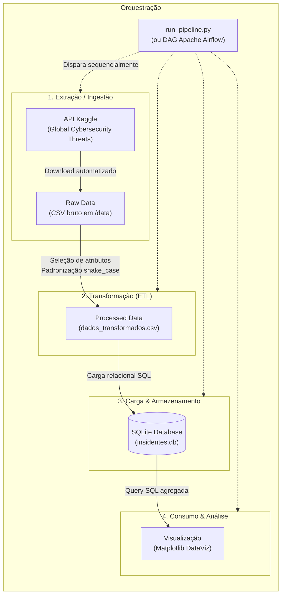

# Pipeline de Engenharia de Dados: Ameaças Globais de Cibersegurança (2015–2024)

> **Universidade de Fortaleza (UNIFOR)**  
> **Programa de Pós-Graduação em Engenharia de Dados**  
> **Autor:** Ricardo Galvão  
> **Repositório:** `airflow_project-main`

---

## 📌 1. Visão Geral do Projeto

Este projeto foi desenvolvido como parte das atividades práticas do curso de **Pós-Graduação em Engenharia de Dados da Universidade de Fortaleza (UNIFOR)**. O objetivo central é implementar um pipeline de dados ponta a ponta (*End-to-End Data Pipeline*) seguindo a metodologia **ETL (Extract, Transform, Load)** com subsequente camada de **Consumo Analítico** (*Data Analytics / Data Visualization*).

O domínio de aplicação escolhido foi a **segurança da informação e análise de riscos cibernéticos globais**, utilizando dados históricos cobrindo o período de 2015 a 2024. O pipeline abrange desde o consumo programático via API externa até a persistência em banco relacional e geração de gráficos gerenciais para tomada de decisão.

---

## 🏗️ 2. Arquitetura da Solução

O fluxo de dados foi desenhado de forma desacoplada e modular, garantindo que cada fase do ciclo de vida dos dados possua responsabilidade única (*Single Responsibility Principle*):



---

## ⚙️ 3. Como o Trabalho Foi Desenvolvido

O desenvolvimento foi estruturado em quatro módulos sequenciais, coordenados por um módulo orquestrador:

### 3.1. Ingestão de Dados (`scripts/01_ingestao.py`)
* **Fonte de Dados:** Dataset público [*Global Cybersecurity Threats (2015–2024)*](https://www.kaggle.com/datasets/atharvasoundankar/global-cybersecurity-threats-2015-2024) disponibilizado no Kaggle.
* **Mecanismo de Coleta:** Integração direta com a **Kaggle API** em Python (`kaggle.api.kaggle_api_extended.KaggleApi`).
* **Implementação:**
  * Configuração segura das credenciais de autenticação (`KAGGLE_USERNAME` e `KAGGLE_KEY`).
  * Download idempotente dos arquivos brutos diretamente para o diretório de dados local (`data/`), realizando o descompactamento automático (`unzip=True`).
  * Validação prévia de existência do arquivo baixado e exibição de amostras iniciais dos registros carregados.

### 3.2. Transformação e Higienização (`scripts/02_transformacao.py`)
* **Tecnologia:** Biblioteca `pandas`.
* **Regras de Negócio e Tratamento:**
  * **Filtragem e Seleção de Features:** Extração estrita dos atributos analíticos essenciais para o estudo de impacto econômico e operacional de ciberataques.
  * **Tradução e Normalização de Metadados:** Conversão dos cabeçalhos em inglês para português e aplicação da convenção de nomenclatura *snake_case* para facilitar a modelagem e consulta no banco de dados.
  * **Exportação Padronizada:** Gravação do dataset tratado no arquivo `data/dados_transformados.csv`.

### 3.3. Carga e Modelagem Relacional (`scripts/03_carga.py`)
* **Tecnologias:** `sqlite3` e `pandas`.
* **Implementação:**
  * Conexão e instanciação da base de dados relacional `data/insidentes.db`.
  * Criação e povoamento da tabela `insidentes` via método `df.to_sql()`.
  * Utilização da estratégia `if_exists='replace'` para assegurar a **idempotência** da carga em execuções sucessivas do pipeline.

### 3.4. Consumo e Análise de Dados (`scripts/04_consumo.py`)
* **Tecnologias:** `sqlite3`, `pandas` e `matplotlib`.
* **Implementação:**
  * Execução de consulta analítica via SQL agrupando incidentes por país com contagem agregada e ordenação decrescente:
    ```sql
    SELECT pais, COUNT(*) AS quantidade_ataques
    FROM insidentes
    GROUP BY pais
    ORDER BY quantidade_ataques DESC;
    ```
  * Construção de gráfico de barras horizontal ordenado, evidenciando as nações com maior incidência de ciberataques no período monitorado.

### 3.5. Orquestração do Pipeline (`run_pipeline.py`)
* Um script executor em Python utiliza `subprocess.run()` para disparar de forma encadeada as 4 etapas, assegurando que uma etapa posterior só seja executada se a anterior concluir com sucesso (`check=True`).
* Essa estrutura desacoplada foi planejada para permitir integração direta com orquestradores de nível de produção, como **Apache Airflow** (por meio de `BashOperator` ou `PythonOperator`).

---

## 📊 4. Dicionário de Dados

Após a etapa de transformação, a tabela `insidentes` armazena os seguintes atributos padronizados:

| Coluna | Tipo | Descrição |
| :--- | :--- | :--- |
| `pais` | `TEXT` | País onde o incidente de segurança foi registrado |
| `ano` | `INTEGER` | Ano da ocorrência do ataque cibernético (2015 a 2024) |
| `tipo_ataque` | `TEXT` | Classificação da ameaça (ex.: *Phishing*, *Ransomware*, *Man-in-the-Middle*) |
| `industria_alvo` | `TEXT` | Setor produtivo impactado (ex.: *IT*, *Retail*, *Telecommunications*, *Education*) |
| `perda_financeira_milhoes_usd` | `REAL` | Prejuízo financeiro estimado em milhões de dólares (USD) |
| `usuarios_afetados` | `INTEGER` | Volume total de contas ou usuários prejudicados pelo evento |
| `origem_ataque` | `TEXT` | Categoria do vetor/agente atacante (ex.: *Hacker Group*, *Nation-state*) |
| `tipo_vulnerabilidade` | `TEXT` | Brecha de segurança explorada (ex.: *Weak Passwords*, *Unpatched Software*) |
| `mecanismo_defesa` | `TEXT` | Solução de mitigação utilizada (ex.: *Firewall*, *VPN*, *AI-based Detection*) |
| `tempo_resolucao_horas` | `INTEGER` | Duração temporal até a mitigação total do incidente (em horas) |

---

## 🗂️ 5. Estrutura do Repositório

```text
airflow_project-main/
│
├── data/                                      # Camada de armazenamento e persistência
│   ├── Global_Cybersecurity_Threats_2015-2024.csv # Dados brutos extraídos da fonte
│   ├── dados_transformados.csv                # Dados higienizados e normalizados
│   └── insidentes.db                          # Banco de dados SQLite final
│
├── scripts/                                   # Módulos operacionais do pipeline
│   ├── 01_ingestao.py                         # Ingestão e autenticação via Kaggle API
│   ├── 02_transformacao.py                    # Limpeza, seleção e tradução de features
│   ├── 03_carga.py                            # Persistência relacional em SQLite
│   ├── 04_consumo.py                          # Análise agregada SQL e DataViz
│   └── kaggle.json                            # Arquivo de configuração de credenciais
│
├── run_pipeline.py                            # Orquestrador local do pipeline completo
├── requirements.txt                           # Dependências de bibliotecas Python
└── README.md                                  # Documentação técnica do trabalho
```

---

## 🚀 6. Instruções de Instalação e Execução

### 6.1. Pré-requisitos
* Python 3.9 ou superior instalado.
* Conta ativa no [Kaggle](https://www.kaggle.com/) com chave de API gerada (`kaggle.json`).

### 6.2. Clonagem e Configuração do Ambiente
```bash
# 1. Clonar o repositório
git clone https://github.com/galvaojdk/airflow_project-main.git
cd airflow_project-main

# 2. Criar e ativar um ambiente virtual (recomendado)
python -m venv venv

# No Windows:
venv\Scripts\activate
# No Linux/macOS:
source venv/bin/activate

# 3. Instalar dependências necessárias
pip install -r requirements.txt
```

### 6.3. Configuração de Credenciais Kaggle
Para permitir que o script `01_ingestao.py` faça o download dos dados:
1. Obtenha seu token de API no Kaggle em **Account -> Create New API Token** (arquivo `kaggle.json`).
2. Mantenha o arquivo em `~/.kaggle/kaggle.json` ou atualize as constantes `KAGGLE_USERNAME` e `KAGGLE_KEY` dentro do arquivo `scripts/01_ingestao.py`.

### 6.4. Execução do Pipeline

#### Opção A: Executar o Pipeline Completo (Recomendado)
```bash
python run_pipeline.py
```

#### Opção B: Executar Etapa por Etapa
```bash
# 1. Ingestão
python scripts/01_ingestao.py

# 2. Transformação
python scripts/02_transformacao.py

# 3. Carga no SQLite
python scripts/03_carga.py

# 4. Consulta e Geração do Gráfico
python scripts/04_consumo.py
```

---

## 🔄 7. Integração com Apache Airflow

A modularização adotada no projeto facilita a migração ou orquestração do pipeline por meio de uma DAG (*Directed Acyclic Graph*) no **Apache Airflow**. Cada script corresponde a uma *task*:

```python
from airflow import DAG
from airflow.operators.bash import BashOperator
from datetime import datetime, timedelta

default_args = {
    'owner': 'unifor_data_eng',
    'start_date': datetime(2024, 1, 1),
    'retries': 1,
    'retry_delay': timedelta(minutes=5),
}

with DAG(
    dag_id='cybersecurity_pipeline',
    default_args=default_args,
    schedule_interval='@daily',
    catchup=False
) as dag:

    ingestao = BashOperator(
        task_id='ingestao_dados',
        bash_command='python /caminho/scripts/01_ingestao.py'
    )

    transformacao = BashOperator(
        task_id='transformacao_dados',
        bash_command='python /caminho/scripts/02_transformacao.py'
    )

    carga = BashOperator(
        task_id='carga_banco',
        bash_command='python /caminho/scripts/03_carga.py'
    )

    consumo = BashOperator(
        task_id='consumo_analise',
        bash_command='python /caminho/scripts/04_consumo.py'
    )

    # Definição das dependências do pipeline
    ingestao >> transformacao >> carga >> consumo
```

---

## 📈 8. Conclusões e Aprendizados

* **Automação do Ciclo de Dados:** Demonstrou-se a capacidade de automatizar a extração e carga de dados sem intervenção manual.
* **Padronização e Qualidade dos Dados:** A higienização de colunas e categorização viabilizou consultas estruturadas de alto desempenho analítico.
* **Prontidão para Produção (*Production-Ready*):** A separação em camadas permite fácil escalabilidade, como a substituição do SQLite por um Data Warehouse em nuvem (ex.: BigQuery, Snowflake ou PostgreSQL) e o orquestrador local pelo Apache Airflow.

---

## 🎓 Instituição & Créditos

* **Instituição:** Universidade de Fortaleza (UNIFOR)
* **Curso:** Pós-Graduação em Engenharia de Dados
* **Aluno / Desenvolvedor:** Ricardo Galvão

